# STUDENT INFORMATION MANAGER

*An Angular Web Application for Managing Department Student Records*

**Subject:** Professional Elective  
**Document Type:** Final Project Documentation

**Submitted by: Group 1**
- Joevan Delos Santos
- Richmon Ecal
- John Yzhekiel Millar
- Celine Licanda

**Submitted to:**  
Mrs. AnaLizel Benedicto Del Poso  
Instructor, Professional Elective

**Submission Date:** November 25, 2026

---

## Table of Contents

1. [1. Project Overview](#1-project-overview)
2. [2. Objectives](#2-objectives)
3. [3. Scope and Limitations](#3-scope-and-limitations)
4. [4. System Requirements](#4-system-requirements)
5. [5. Interface Plan](#5-interface-plan)
6. [6. Application Structure](#6-application-structure)
7. [7. Angular Topics Applied](#7-angular-topics-applied)
8. [8. API Documentation](#8-api-documentation)
9. [9. Exploration Report: Angular Router](#9-exploration-report-angular-router)
10. [10. Installation and User Guide](#10-installation-and-user-guide)
11. [11. Testing Results](#11-testing-results)
12. [12. Member Contribution Report and Individual Reflections](#12-member-contribution-report-and-individual-reflections)
13. [13. Conclusion and Recommendations](#13-conclusion-and-recommendations)
14. [14. References](#14-references)

---

## 1. Project Overview

### 1.1 Background and Problem Addressed
Academic departments and university registrars routinely manage student enrollment records across multiple degree programs and year levels. In small-scale or instructional settings, tracking student numbers, degree programs, academic standing (`Active`, `Probation`, `On Leave`, `Graduated`), cumulative GPA, and assigned faculty advisors using disconnected spreadsheets leads to formatting errors, inconsistent data entry, weak searchability, and broken cross-references between summary metrics and individual profiles.

### 1.2 Intended Users
- **University Registrar Clerks:** Register new students, update academic standing or GPA after each term, and maintain accurate contact and advisor details.
- **Faculty Advisors:** Search advisees quickly by name, student number, or advisor name, and inspect individual student dossiers during advising sessions.
- **Department Coordinators:** Review enrollment distribution by degree program (`BSCS`, `BSIT`, `BSIS`, `BSCE`, `BSECE`) and year level (1st through 4th Year), then click directly into filtered student rosters.

### 1.3 Application Purpose
The **Student Information Manager (SIM)** provides a structured, API-connected Angular single-page application that centralizes student records with strict client-side validation, persistent CRUD operations via a REST API, instant multi-criteria search and filtering, and URL-driven routing between overview metrics, student rosters, and individual student dossiers.

---

## 2. Objectives

### 2.1 General Objective
To design, develop, and verify an API-connected Angular 22 single-page application that enables an academic department to organize, search, filter, and persist student enrollment records while demonstrating core Angular concepts and an independent exploration of **Angular Router**.

### 2.2 Specific Objectives
1. Architect a modular Angular application with at least four meaningful standalone components (`NavbarComponent`, `DashboardComponent`, `StudentListComponent`, and `StudentDetailComponent`, hosted inside `AppComponent`) backed by an injectable `StudentService`.
2. Apply modern Angular control flow (`@if`, `@for` with `track`, and `@switch`), all four data-binding types (interpolation, property binding, event binding, and two-way binding), HTTP CRUD operations, and RxJS Observables consumed via `subscribe()`.
3. Implement full Create, Read, Update, and Delete (CRUD) operations alongside multi-field search and course/year-level filtering backed by a writable local `json-server` REST API (`db.json`) so changes persist across browser refreshes.
4. Explore and integrate **Angular Router** using separate Dashboard, Student Directory, Registration, and Student Detail views, static-before-dynamic route precedence, URL-synchronized query parameters, programmatic navigation, document titles, and wildcard fallbacks.
5. Deliver an accessible, responsive, high-contrast dark-mode interface covering all UI feedback states (loading skeletons, success banners, inline validation, empty states, and API error recovery), verified through automated Vitest tests and 10 live end-to-end test cases.

---

## 3. Scope and Limitations

### 3.1 Scope (Included Features)
- **Academic Overview Dashboard (`/dashboard`):** Live computed metrics (Total Enrolled, Active, Needs Attention, Mean Cumulative GPA), clickable program and year-level breakdowns, and recent registrations table.
- **Searchable & Filterable Student Directory (`/students`):** Real-time debounced search (name, student number, email, course, advisor) plus Course and Year Level dropdowns bidirectionally synchronized with URL query parameters (`?q=`, `?course=`, `?yearLevel=`).
- **Unified Student Record Workflows (`/students/new`, `/students/:id`, `/students/:id?edit=true`):** Validated registration form, read-only Academic Dossier, pre-filled edit mode, and safe record deletion with keyboard-accessible confirmation (`Escape` to cancel).
- **Complete UI Feedback & Accessibility:** Skeleton loading states, dismissible confirmation banners, inline validation messages, empty-database and empty-filter states, offline API error banners with Retry, and mobile responsive reflow.
- **Automated & End-to-End Verification:** 8 Vitest unit tests (`StudentService` HTTP operations and route matching) plus 10 live browser end-to-end test cases.

### 3.2 Limitations
- **Local Mock Persistence:** Data is stored in a local `db.json` file served by `json-server` rather than a multi-user relational database (PostgreSQL/MySQL). Concurrent writes from multiple clients are not locked or transactional.
- **No Authentication or Role-Based Access Control (RBAC):** Any user with access to the local development server can view, create, edit, and delete student records.
- **Client-Side Search Projection:** Because `json-server` v1 removed legacy `?q=` full-text search parameters, multi-field filtering executes in the RxJS pipeline inside `StudentService.searchStudents()` after fetching `/students`, which is suited for departmental cohorts rather than tens of thousands of records without server-side pagination.
- **Single-Term GPA Snapshot:** The schema stores each student's current cumulative GPA rather than multi-semester transcript histories.

---

## 4. System Requirements

The table below lists the exact software, frameworks, libraries, and runtime tools used to develop, test, and run the Student Information Manager.

| Category | Software / Tool | Version Used | Purpose |
| --- | --- | --- | --- |
| **Runtime Environment** | Node.js | `v24.19.0` (compatible with `v20.19+` / `v22+`) | JavaScript runtime for Angular CLI and `json-server` |
| **Package Manager** | npm | `11.17.0` | Dependency installation and workspace script execution |
| **Frontend Framework** | Angular (`@angular/core`, `common`, `forms`, `router`, `platform-browser`) | `^22.1.0` | Standalone SPA components, Signals, Zoneless mode, Routing, Forms, `HttpClient` |
| **CLI & Build System** | `@angular/cli` & `@angular/build` | `^22.1.7` | Development server (`ng serve`), production builds (`ng build`), test runner |
| **Programming Language** | TypeScript | `~6.0.2` | Strict static typing for models, services, and components |
| **Reactive Library** | RxJS | `~7.8.0` | Observable streams, operators (`switchMap`, `combineLatest`, `debounceTime`, `map`, `catchError`) |
| **Local Mock REST API** | `json-server` | `^1.0.0-beta.15` | Writable local REST backend persisting records to `db.json` on port `3000` |
| **Unit Testing** | Vitest & `jsdom` | `^4.0.8` / `^28.0.0` | Automated unit testing for `StudentService` and `AppComponent` routing |
| **Code Formatting** | Prettier | `^3.8.1` | Consistent TypeScript, HTML, and CSS formatting |
| **Browser & IDE** | Chrome / Edge / Firefox & VS Code | Modern evergreen | Running the Angular app, DevTools inspection, and source editing |

---

## 5. Interface Plan

### 5.1 Design Direction
The interface uses a utilitarian, high-density dark zinc palette (`#09090b` canvas, `#111113` surfaces, crisp `1px` `#27272a` borders) paired with a single cobalt accent (`#2563eb`) and tabular monospace numbers (`IBM Plex Mono`)—prioritizing scannability, WCAG AA contrast, keyboard accessibility, and zero horizontal overflow on desktop and mobile viewports.

### 5.2 Initial Sketches
Wireframe sketches planning the sticky navigation shell, Academic Overview metric strip and breakdowns, Student Directory filter toolbar, and Student Detail dossier/form layout:

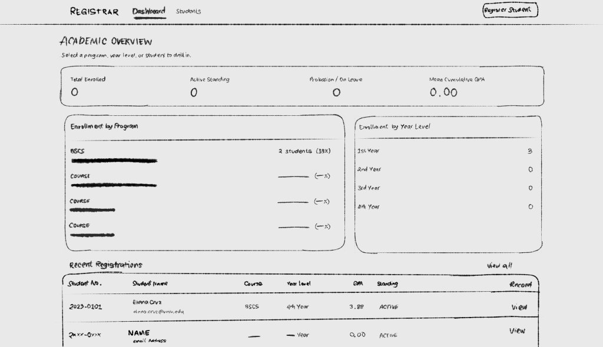
*Sketch 1: Initial wireframe of the Academic Overview Dashboard (`/dashboard`) showing the navigation shell, KPI strip, program/year breakdowns, and recent registrations table.*

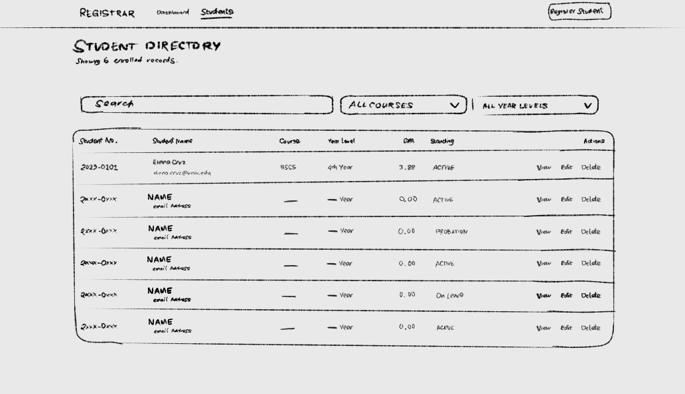
*Sketch 2: Initial wireframe of the Student Directory (`/students`) showing the search input, course and year-level filter dropdowns, and roster action controls.*

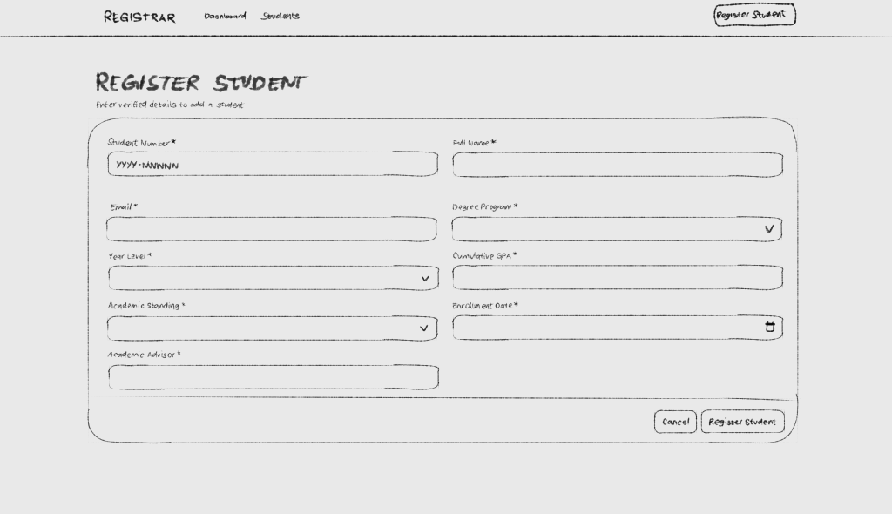
*Sketch 3: Initial wireframe of the Register Student form (`/students/new`) outlining the two-column grid for all ten required student fields and submission controls.*

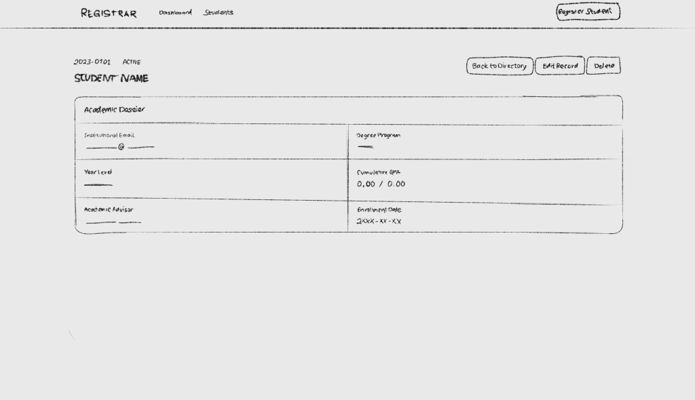
*Sketch 4: Initial wireframe of the Student Academic Dossier (`/students/:id`) displaying the student header, record action buttons, and two-column academic profile grid.*

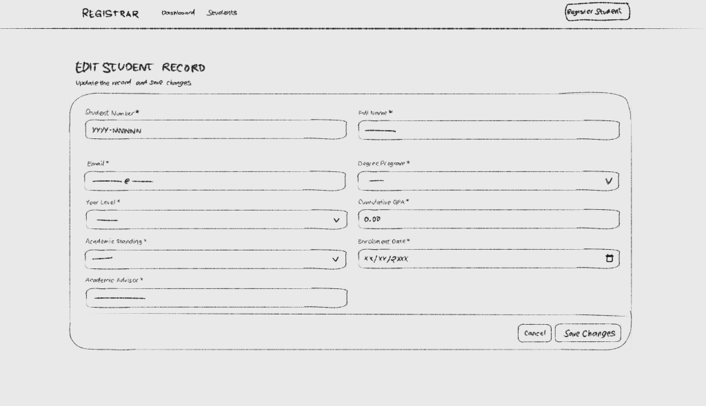
*Sketch 5: Initial wireframe of the Edit Student Record view (`/students/:id?edit=true`) featuring pre-filled form fields alongside Cancel and Save Changes actions.*

### 5.3 Final Screenshots
Captured screenshots of the running application across desktop and mobile viewports (Dashboard, Student Directory with active filters, Student Dossier, Registration/Edit validation states, and Delete confirmation):

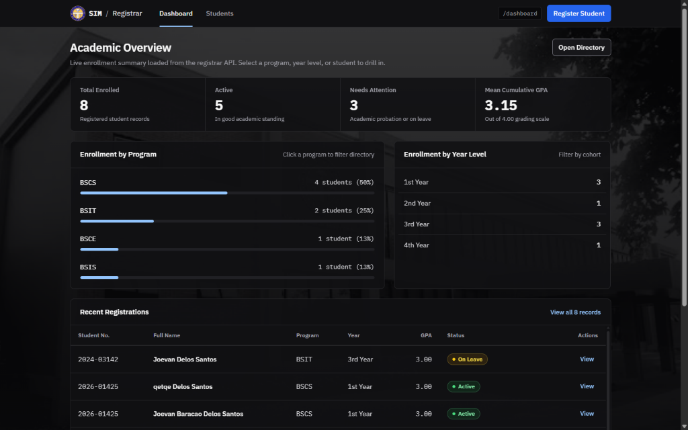
*Desktop (1440×900): Academic Overview Dashboard (`/dashboard`) displaying live KPIs, program and year-level breakdowns, and recent registrations.*

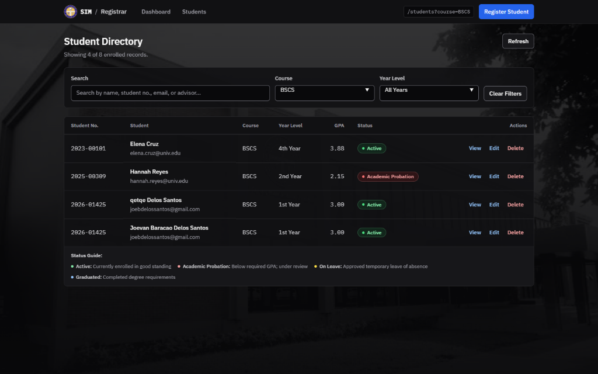
*Desktop (1440×900): Student Directory filtered by `BSCS` with URL synchronization (`/students?course=BSCS`) and the Clear Filters button.*


*Desktop (1440×900): Student Academic Dossier (`/students/1`) displaying full student metadata alongside Edit Record and Delete actions.*


*Desktop (1440×900): Registration form validation state (`/students/new`) showing the summary alert banner and per-field inline validation messages.*

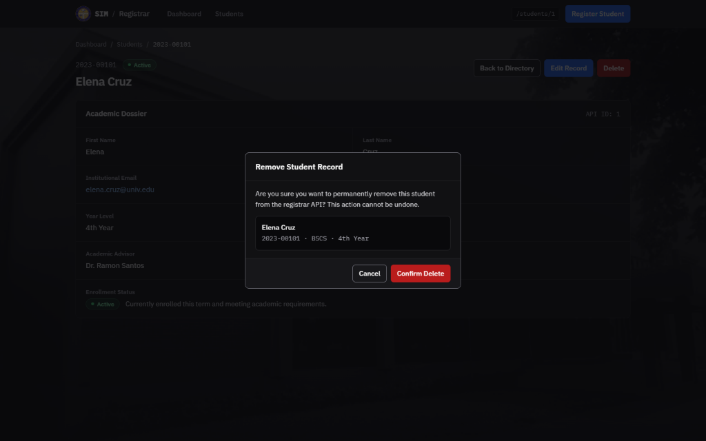
*Desktop (1440×900): Keyboard-accessible delete confirmation modal (`Remove Student Record`) guarding permanent deletion.*

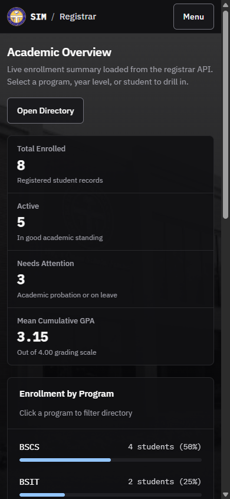
*Mobile (390×844): Responsive Dashboard with stacked KPI cards, mobile Menu button, and zero horizontal overflow.*

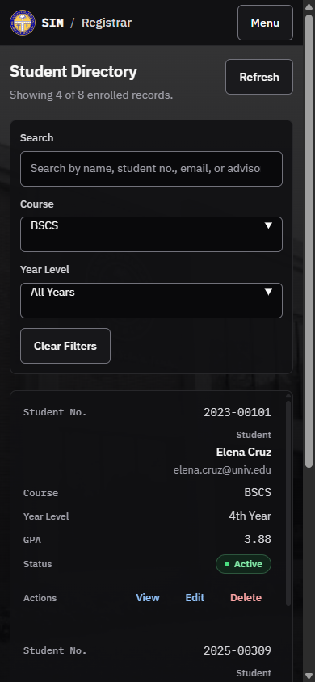
*Mobile (390×844): Responsive Student Directory (`/students?course=BSCS`) with stacked filter controls and card-style student rows.*

---

## 6. Application Structure

### 6.1 Directory Layout

```text
StudentInformationManagement/
├── db.json                                  # Local json-server database (5 seed students)
├── package.json                             # Dependencies and npm scripts (start, api, build, test)
├── package-lock.json                        # Exact dependency lockfile
├── README.md                                # Quick-start overview and route summary
├── src/
│   ├── index.html                           # Application shell and IBM Plex fonts
│   ├── main.ts                              # Standalone bootstrap entry point
│   ├── styles.css                           # Global WCAG AA dark-zinc tokens & shared table/button CSS
│   └── app/
│       ├── app.config.ts                    # ApplicationConfig: provideRouter + provideHttpClient
│       ├── app.routes.ts                    # Centralized Angular Router table
│       ├── app.component.{ts,html,css}      # Root layout: skip-link, NavbarComponent, <router-outlet>
│       ├── app.component.spec.ts            # Root shell & routing unit tests (2 specs)
│       ├── models/
│       │   └── student.model.ts             # TypeScript interfaces & academic enum constants
│       ├── services/
│       │   ├── student.service.ts           # Injectable HTTP CRUD + RxJS search & error handling
│       │   └── student.service.spec.ts      # HttpTestingController unit tests (6 specs)
│       └── components/
│           ├── navbar/
│           │   └── navbar.component.{ts,html,css}
│           ├── dashboard/
│           │   └── dashboard.component.{ts,html,css}
│           ├── student-list/
│           │   └── student-list.component.{ts,html,css}
│           └── student-detail/
│               └── student-detail.component.{ts,html,css}
└── docs/
    ├── PROJECT_DOCUMENTATION.md             # Complete Markdown documentation
    └── PROJECT_DOCUMENTATION.html           # Print-ready HTML for browser PDF export
```

### 6.2 Component, Routing, Model, and Service Responsibilities

| Artifact | File Path | Core Responsibilities |
| --- | --- | --- |
| **Root Shell (`AppComponent`)** | `src/app/app.component.ts` | Hosts the accessibility skip link, persistent `<app-navbar />`, and primary `<router-outlet />` container for all routed views. |
| **Student Model** | `src/app/models/student.model.ts` | Defines strict TypeScript types (`Student`, `StudentPayload`, `StudentStatus`, `YearLevel`, `StudentFilterCriteria`) and shared constants (`COURSE_OPTIONS`, `YEAR_LEVEL_OPTIONS`, `STATUS_OPTIONS`). |
| **StudentService** | `src/app/services/student.service.ts` | Root-injected singleton (`providedIn: 'root'`) encapsulating all HTTP CRUD communication with `http://localhost:3000/students` (`getStudents`, `getStudentById`, `searchStudents`, `addStudent`, `updateStudent`, `deleteStudent`) and centralized `HttpErrorResponse` normalization. |
| **App Routing & Config** | `src/app/app.routes.ts`, `src/app/app.config.ts` | Declares all application routes, static-before-dynamic route precedence (`/students/new` before `/students/:id`), route `data` flags, browser `<title>` metadata, default empty-path redirect, wildcard fallback, and global providers (`provideRouter`, `provideHttpClient`). |
| **NavbarComponent** | `src/app/components/navbar/navbar.component.ts` | Persistent top navigation bar with `routerLink` destinations (`Dashboard`, `Students`, `Register Student`), active route underlines via `routerLinkActive`, live active path readout subscribed to `Router.events` (`NavigationEnd`), and an accessible mobile `Menu` drawer closable via `Escape`. |
| **DashboardComponent** | `src/app/components/dashboard/dashboard.component.ts` | Fetches live student records on initialization, derives summary figures (`totalStudents`, `activeCount`, `attentionCount`, `averageGpa`), renders clickable Course and Year Level breakdowns that programmatically navigate to pre-filtered `/students` URLs, and lists recent registrations with direct profile links. |
| **StudentListComponent** | `src/app/components/student-list/student-list.component.ts` | Full student directory supporting debounced RxJS search (`Subject` + `debounceTime` + `switchMap`), `course` and `yearLevel` dropdown filters synchronized bidirectionally with URL query parameters, loading/empty/error states, inline `View`/`Edit` routing, and guarded `Delete` confirmation (`Escape` to cancel). |
| **StudentDetailComponent** | `src/app/components/student-detail/student-detail.component.ts` | Multi-mode detail component driven by `ActivatedRoute` (`data`, `paramMap`, and `queryParamMap`). Renders the validated registration form (`/students/new`), read-only Academic Dossier (`/students/:id`), pre-filled edit form (`/students/:id?edit=true`), record deletion, and 404/network recovery states. |

---

## 7. Angular Topics Applied

### 7.1 Curriculum Topic Mapping

| Angular / RxJS Concept | Where Used in Code | Implementation Details |
| --- | --- | --- |
| **Interpolation (`{{ ... }}`)** | `navbar.component.html`, `dashboard.component.html`, `student-list.component.html`, `student-detail.component.html` | Renders live values such as `{{ currentPath() }}`, `{{ totalStudents() }}`, `{{ averageGpa() \| number: '1.2-2' }}`, `{{ student.fullName }}`, `{{ feedbackMessage() }}`, and `{{ breadcrumbLabel() }}`. |
| **Property Binding (`[...]`)** | All 4 component templates | Dynamically binds `[routerLink]="['/students', student.id]"`, `[queryParams]="{ edit: 'true' }"`, `[style.width.%]="item.percentage"`, `[disabled]="isSubmitting()"`, `[attr.aria-expanded]`, `[attr.aria-invalid]`, `[ngValue]`, and `[href]`. |
| **Event Binding (`(...)`)** | All 4 component templates + component `host` metadata | Captures user events: `(click)="openCourseFilter(item.course)"`, `(click)="confirmDelete()"`, `(ngSubmit)="submitForm(studentForm)"`, `(ngModelChange)="onFiltersChanged()"`, and host keyboard listeners `'(document:keydown.escape)'`. |
| **Two-Way Binding (`[(ngModel)]`)** | `student-list.component.html`, `student-detail.component.html` | Synchronizes filter controls (`[(ngModel)]="searchTerm"`, `selectedCourse`, `selectedYearLevel`) and all 10 student registration/edit form fields (`[(ngModel)]="formModel.*"`) with component state. |
| **Control Flow: `@if` / `@else`** | `navbar.component.html`, `student-list.component.html`, `student-detail.component.html` | Conditionally renders the mobile menu drawer, confirmation banners, active filter reset button, delete alert dialog, and per-field validation messages. |
| **Control Flow: `@for` with `track`** | `dashboard.component.html`, `student-list.component.html`, `student-detail.component.html` | Efficiently iterates over students (`track student.id`), course breakdowns (`track item.course`), year levels (`track year.yearLevel`), select options, and loading skeleton rows. |
| **Control Flow: `@switch` / `@case` / `@default`** | `dashboard.component.html`, `student-list.component.html`, `student-detail.component.html` | Renders view states (`loading`, `error`, `empty`, `empty-db`, `empty-filter`, `ready`), detail page modes (`create`, `view`, `edit`), and semantic academic standing indicators. |
| **RxJS Observables & `subscribe()`** | `student.service.ts` + all 4 components | Returns typed Observables (`pipe(map, catchError)`), executes debounced search (`Subject` + `debounceTime(120)` + `switchMap`), combines route streams (`combineLatest` + `switchMap`), and consumes responses explicitly with `.subscribe({ next, error })` and `takeUntilDestroyed`. |
| **Injected Angular Services & HTTP CRUD** | `student.service.ts`, `app.config.ts`, `dashboard`, `student-list`, `student-detail` | Registers `provideHttpClient(withFetch())`, defines `@Injectable({ providedIn: 'root' }) StudentService` injected via `inject(StudentService)`, and performs `GET`, `POST`, `PUT`, and `DELETE` against `http://localhost:3000/students`. |
| **Angular Router** | `app.routes.ts`, `app.config.ts`, `app.component.html`, all 4 components | Configures `provideRouter(routes, withComponentInputBinding())`, `<router-outlet />`, declarative `routerLink` / `routerLinkActive`, programmatic `router.navigate`, `:id` params, URL query params, route `data`, navigation `state`, and wildcard `**` fallback. |

### 7.2 Relevant Code Excerpts

#### Excerpt 1: Interpolation, Property Binding, `@for` with `track`, and `@switch` (`dashboard.component.html`)
```html
@switch (viewState()) {
  @case ('ready') {
    <div class="breakdown-list">
      @for (item of courseBreakdown(); track item.course) {
        <button type="button" class="breakdown-row" (click)="openCourseFilter(item.course)">
          <div class="breakdown-top">
            <span class="course-code mono">{{ item.course }}</span>
            <span class="breakdown-count mono">
              {{ item.count }} {{ item.count === 1 ? 'student' : 'students' }} ({{ item.percentage }}%)
            </span>
          </div>
          <div class="bar-track" aria-hidden="true">
            <div class="bar-fill" [style.width.%]="item.percentage"></div>
          </div>
        </button>
      }
    </div>
  }
}
```

#### Excerpt 2: Two-Way Binding (`[(ngModel)]`), Event Binding, and `@if` (`student-list.component.html`)
```html
<input
  id="student-search"
  type="search"
  class="control"
  placeholder="Search by name, student no., email, or advisor..."
  [(ngModel)]="searchTerm"
  (ngModelChange)="onFiltersChanged()"
/>

@if (hasActiveFilters()) {
  <div class="field-action">
    <button type="button" class="btn" (click)="clearFilters()">Clear Filters</button>
  </div>
}
```

#### Excerpt 3: Template-Driven Form Validation & Inline Feedback (`student-detail.component.html`)
```html
<input
  id="studentNumber"
  name="studentNumber"
  type="text"
  class="control mono"
  required
  pattern="^\d{4}-\d{5}$"
  [(ngModel)]="formModel.studentNumber"
  #studentNumberCtrl="ngModel"
  [attr.aria-invalid]="studentNumberCtrl.invalid && (studentNumberCtrl.touched || formSubmitted())"
/>
@if (studentNumberCtrl.invalid && (studentNumberCtrl.touched || formSubmitted())) {
  <span id="studentNumber-err" class="field-error" role="alert">
    @if (studentNumberCtrl.errors?.['required']) {
      Student number is required.
    } @else {
      Use format YYYY-NNNNN (example: 2026-00142).
    }
  </span>
}
```

#### Excerpt 4: Injected Service, HTTP CRUD, and RxJS Error Handling (`student.service.ts`)
```typescript
@Injectable({ providedIn: 'root' })
export class StudentService {
  private readonly http = inject(HttpClient);
  private readonly apiUrl = 'http://localhost:3000/students';

  getStudents(): Observable<Student[]> {
    return this.http
      .get<Student[]>(this.apiUrl)
      .pipe(catchError((error: HttpErrorResponse) => this.handleError(error, 'load student records')));
  }

  addStudent(payload: StudentPayload): Observable<Student> {
    return this.http
      .post<Student>(this.apiUrl, payload)
      .pipe(catchError((error: HttpErrorResponse) => this.handleError(error, 'create student record')));
  }

  updateStudent(id: string, payload: StudentPayload): Observable<Student> {
    return this.http
      .put<Student>(`${this.apiUrl}/${encodeURIComponent(id)}`, { id, ...payload })
      .pipe(catchError((error: HttpErrorResponse) => this.handleError(error, 'update student record')));
  }

  deleteStudent(id: string): Observable<void> {
    return this.http
      .delete<void>(`${this.apiUrl}/${encodeURIComponent(id)}`)
      .pipe(catchError((error: HttpErrorResponse) => this.handleError(error, 'delete student record')));
  }
}
```

#### Excerpt 5: Observables, `combineLatest`, `switchMap`, and `subscribe()` (`student-detail.component.ts`)
```typescript
combineLatest([this.route.data, this.route.paramMap, this.route.queryParamMap])
  .pipe(
    switchMap(([data, params, queryParams]) => {
      const routeMode = data['mode'] as string | undefined;
      const id = params.get('id');
      const editFlag = queryParams.get('edit') === 'true';

      if (routeMode === 'create' || !id) {
        this.pageState.set('create');
        return of(null);
      }

      this.currentId.set(id);
      this.pageState.set('loading');
      return this.studentService.getStudentById(id).pipe(
        map((record) => ({ record, targetState: (editFlag ? 'edit' : 'view') as 'view' | 'edit' })),
        catchError((err: Error) => {
          this.errorMessage.set(err.message);
          this.pageState.set('error');
          return of(null);
        })
      );
    }),
    takeUntilDestroyed(this.destroyRef)
  )
  .subscribe((result) => {
    if (!result) return;
    this.student.set(result.record);
    this.populateForm(result.record);
    this.pageState.set(result.targetState);
  });
```

#### Excerpt 6: Angular Router Configuration & Static Route Precedence (`app.routes.ts`)
```typescript
export const routes: Routes = [
  { path: '', redirectTo: 'dashboard', pathMatch: 'full' },
  { path: 'dashboard', component: DashboardComponent, title: 'Dashboard | Student Information Manager' },
  { path: 'students', component: StudentListComponent, title: 'Student Directory | Student Information Manager' },
  { path: 'students/new', component: StudentDetailComponent, data: { mode: 'create' }, title: 'Register Student | Student Information Manager' },
  { path: 'students/:id', component: StudentDetailComponent, data: { mode: 'view' }, title: 'Student Record | Student Information Manager' },
  { path: '**', redirectTo: 'dashboard' }
];
```

---

## 8. API Documentation

### 8.1 Server Configuration and Provider
- **API Provider:** Local `json-server` (`^1.0.0-beta.15`) serving `db.json`
- **Base URL:** `http://localhost:3000`
- **Resource Collection:** `/students`
- **Start Command:** `npm run api` (executes `json-server db.json --port 3000`)
- **Content Type:** `application/json`

### 8.2 Student Resource Schema (Data Fields)

| Field | Type | Constraints / Format | Example |
| --- | --- | --- | --- |
| `id` | `string` | Unique identifier assigned by `json-server` on `POST` | `"1"` |
| `studentNumber` | `string` | Required, pattern `^\d{4}-\d{5}$` | `"2023-00101"` |
| `firstName` | `string` | Required, 2 to 50 characters | `"Elena"` |
| `lastName` | `string` | Required, 2 to 50 characters | `"Cruz"` |
| `fullName` | `string` | Derived automatically from `firstName` + `lastName` | `"Elena Cruz"` |
| `email` | `string` | Required, valid email address | `"elena.cruz@univ.edu"` |
| `course` | `string` | Required (`BSCS`, `BSIT`, `BSIS`, `BSCE`, `BSECE`) | `"BSCS"` |
| `yearLevel` | `number` | Required integer (`1`, `2`, `3`, or `4`) | `4` |
| `gpa` | `number` | Required decimal between `0.00` and `4.00` | `3.88` |
| `status` | `string` | Required (`Active`, `Probation`, `On Leave`, `Graduated`) | `"Active"` |
| `enrolledDate` | `string` | Required ISO date `YYYY-MM-DD` | `"2023-08-14"` |
| `advisor` | `string` | Required, 3 to 80 characters | `"Dr. Ramon Santos"` |

### 8.3 Endpoints Reference

| Operation | HTTP Method | Endpoint | Success Status | Description |
| --- | --- | --- | --- | --- |
| List all students | `GET` | `/students` | `200 OK` | Returns the full array of student objects from `db.json`. |
| View single student | `GET` | `/students/:id` | `200 OK` | Returns a single student matching `id`, or `404 Not Found`. |
| Register student | `POST` | `/students` | `201 Created` | Persists a new student record and returns the saved object with its generated `id`. |
| Update student | `PUT` | `/students/:id` | `200 OK` | Replaces the full student record matching `id` and returns the updated object. |
| Delete student | `DELETE` | `/students/:id` | `200 OK` | Permanently removes the student record matching `id` from `db.json`. |

### 8.4 Sample JSON Requests and Responses

#### `GET /students` (`200 OK`)
```json
[
  {
    "id": "1",
    "studentNumber": "2023-00101",
    "firstName": "Elena",
    "lastName": "Cruz",
    "fullName": "Elena Cruz",
    "email": "elena.cruz@univ.edu",
    "course": "BSCS",
    "yearLevel": 4,
    "gpa": 3.88,
    "status": "Active",
    "enrolledDate": "2023-08-14",
    "advisor": "Dr. Ramon Santos"
  },
  {
    "id": "2",
    "studentNumber": "2024-00214",
    "firstName": "Marco",
    "lastName": "Villanueva",
    "fullName": "Marco Villanueva",
    "email": "marco.villanueva@univ.edu",
    "course": "BSIT",
    "yearLevel": 3,
    "gpa": 3.42,
    "status": "Active",
    "enrolledDate": "2024-08-12",
    "advisor": "Prof. Carla Mendoza"
  }
]
```

#### `GET /students/1` (`200 OK`)
```json
{
  "id": "1",
  "studentNumber": "2023-00101",
  "firstName": "Elena",
  "lastName": "Cruz",
  "fullName": "Elena Cruz",
  "email": "elena.cruz@univ.edu",
  "course": "BSCS",
  "yearLevel": 4,
  "gpa": 3.88,
  "status": "Active",
  "enrolledDate": "2023-08-14",
  "advisor": "Dr. Ramon Santos"
}
```

#### `POST /students`
**Request Body:**
```json
{
  "studentNumber": "2026-00601",
  "firstName": "Andrea",
  "lastName": "Tolentino",
  "fullName": "Andrea Tolentino",
  "email": "andrea.tolentino@univ.edu",
  "course": "BSIT",
  "yearLevel": 2,
  "gpa": 3.74,
  "status": "Active",
  "enrolledDate": "2026-08-20",
  "advisor": "Prof. Carla Mendoza"
}
```

**Response (`201 Created`):**
```json
{
  "id": "Kub7wECDAIQ",
  "studentNumber": "2026-00601",
  "firstName": "Andrea",
  "lastName": "Tolentino",
  "fullName": "Andrea Tolentino",
  "email": "andrea.tolentino@univ.edu",
  "course": "BSIT",
  "yearLevel": 2,
  "gpa": 3.74,
  "status": "Active",
  "enrolledDate": "2026-08-20",
  "advisor": "Prof. Carla Mendoza"
}
```

#### `PUT /students/Kub7wECDAIQ`
**Request Body & Response (`200 OK`):**
```json
{
  "id": "Kub7wECDAIQ",
  "studentNumber": "2026-00601",
  "firstName": "Andrea",
  "lastName": "Tolentino",
  "fullName": "Andrea Tolentino",
  "email": "andrea.tolentino@univ.edu",
  "course": "BSIT",
  "yearLevel": 2,
  "gpa": 3.91,
  "status": "Probation",
  "enrolledDate": "2026-08-20",
  "advisor": "Prof. Carla Mendoza"
}
```

#### `DELETE /students/Kub7wECDAIQ`
**Response (`200 OK`):**
```json
{
  "id": "Kub7wECDAIQ",
  "studentNumber": "2026-00601",
  "firstName": "Andrea",
  "lastName": "Tolentino",
  "fullName": "Andrea Tolentino",
  "email": "andrea.tolentino@univ.edu",
  "course": "BSIT",
  "yearLevel": 2,
  "gpa": 3.91,
  "status": "Probation",
  "enrolledDate": "2026-08-20",
  "advisor": "Prof. Carla Mendoza"
}
```
Removes the matching student entry permanently from `db.json`.

#### Error Handling Responses
- **`404 Not Found`** (e.g., `GET /students/999`): `StudentService.handleError()` intercepts the `HttpErrorResponse` and emits `"The requested student record was not found."`
- **Network Error (`status: 0`)** (when `json-server` is offline): `StudentService.handleError()` emits `"Cannot reach the local API server at http://localhost:3000. Start json-server and retry."`
- **Client / Server Errors (`4xx` / `5xx`):** Normalized into human-readable action messages (`"Request rejected (4xx)..."` or `"The API server encountered an internal error (5xx)..."`) displayed in UI alert banners.

---

## 9. Exploration Report: Angular Router

### 9.1 Feature Explored and Why It Is Useful
Our group explored **Angular Router (`@angular/router`)**. In a multi-view administrative tool such as a Student Information Manager, rendering every screen conditionally with boolean flags inside a single root component breaks core browser expectations: users cannot bookmark a student's profile, cannot share a pre-filtered roster link (such as all 2nd Year BSCS students), and cannot press the browser Back or Forward buttons to return to a previous screen.

**Angular Router** solves these issues by mapping browser URL paths, dynamic segments, and query parameters directly to standalone Angular components inside `<router-outlet>` without performing full-page document reloads. It also synchronizes browser `<title>` tags per route, tracks active links declaratively via `routerLinkActive`, passes ephemeral cross-route confirmation messages via `history.state`, and provides wildcard fallbacks for unrecognized URLs.

### 9.2 Sources Consulted
1. **Angular Official Routing Guide** (`https://angular.dev/guide/routing`)
2. **Angular API Reference: `ActivatedRoute` & `Router`** (`https://angular.dev/api/router/ActivatedRoute`, `https://angular.dev/api/router/Router`)
3. **Angular API Reference: `RouterLinkActive`** (`https://angular.dev/api/router/RouterLinkActive`)
4. **Angular Zoneless & Signals Interop Guide** (`https://angular.dev/guide/zoneless`)
5. **RxJS `switchMap` & `combineLatest` Documentation** (`https://rxjs.dev/api/operators/switchMap`, `https://rxjs.dev/api/index/function/combineLatest`)

### 9.3 Experiment Performed
To evaluate Angular Router behavior in standalone Angular 22, our group ran a four-part controlled experiment:
1. **Route Precedence Test:** Verified first-match-wins behavior when both static (`students/new`) and dynamic (`students/:id`) routes share `/students/`.
2. **Same-Component Reuse Test:** Navigated between `/students/new`, `/students/:id`, and `/students/:id?edit=true` while all three resolved to `StudentDetailComponent`, observing lifecycle reuse behavior.
3. **Query Parameter Synchronization Test:** Wired Dashboard breakdowns to navigate via `router.navigate(['/students'], { queryParams: { course } })` and verified bidirectional URL sync and page reload persistence.
4. **Navigation State & Fallback Test:** Verified transient banners via `history.state`, tested 404 invalid IDs (`/students/999`), and confirmed arbitrary unknown URLs (`/does-not-exist`) redirected cleanly to `/dashboard`.

### 9.4 Problems Occurred and How They Were Resolved
1. **Static vs. Parameterized Route Collision (`/students/new` vs. `/students/:id`):** Placing `students/:id` above `students/new` caused Angular Router to treat `"new"` as an `:id` parameter and trigger a `404` API request. *Fix:* Declared `students/new` strictly above `students/:id` in `src/app/app.routes.ts` with `data: { mode: 'create' }` and added a unit test in `app.component.spec.ts`.
2. **Same-Component Reuse Without Re-Running `ngOnInit()`:** Reading `route.snapshot` failed when moving from `/students/new` to `/students/:id` or toggling `?edit=true`. *Fix:* Subscribed to `combineLatest([this.route.data, this.route.paramMap, this.route.queryParamMap])` piped through `switchMap()` and `takeUntilDestroyed()`.
3. **Zoneless Angular 22 Change Detection with Async Streams:** Without `zone.js`, plain class fields mutated inside `Router.events` or HTTP subscriptions do not trigger DOM refreshes reliably. *Fix:* Stored reactive UI state in Angular Signals (`signal()` and `computed()`).
4. **Empty Query Parameters Polluting Browser History:** Writing empty strings (`?q=&course=`) cluttered URLs and pushed extra Back-button entries on every keystroke. *Fix:* Mapped cleared values to `null` with `replaceUrl: true`.

### 9.5 How the Final Implementation Works
- `app.config.ts` registers `provideRouter(routes, withComponentInputBinding())` and `provideHttpClient(withFetch())`.
- `app.routes.ts` defines 6 routes (`''` -> `/dashboard`, `/dashboard`, `/students`, `/students/new`, `/students/:id`, and `**` -> `/dashboard`) with page titles.
- `NavbarComponent` binds `routerLink` / `routerLinkActive` and subscribes to `Router.events` (`NavigationEnd`) to show the live active route.
- `DashboardComponent` triggers programmatic navigation (`openCourseFilter`, `openYearFilter`) to filtered `/students` routes.
- `StudentListComponent` syncs `ActivatedRoute.queryParamMap` bidirectionally with search/filter controls.
- `StudentDetailComponent` handles Create, View, and Edit modes reactively via `@switch (pageState())`.

---

## 10. Installation and User Guide

### 10.1 Installation Guide

#### 1. Prerequisites Check
Verify that **Node.js** (v20.19+ / v22+ / v24+) and **npm** (v10+) are installed:
```bash
node -v
npm -v
```

#### 2. Install Dependencies
Navigate to the project folder and install all packages from `package-lock.json`:
```bash
cd StudentInformationManagement
npm install
```

#### 3. Start the Application (Two Concurrent Terminals)
Open **two terminal windows** in the project root directory:

**Terminal 1 — Start the local `json-server` mock REST API (Port `3000`):**
```bash
npm run api
```
Confirm the API is listening at `http://localhost:3000/students`.

**Terminal 2 — Start the Angular development server (Port `4200`):**
```bash
npm start
```
Open `http://localhost:4200` in your browser (it automatically redirects to `http://localhost:4200/dashboard`).

#### 4. Optional Verification & Production Build Commands
```bash
npx tsc --noEmit   # Strict TypeScript check
npm test           # Run Vitest unit tests
npm run build      # Build production bundle into dist/
```

### 10.2 End-User Guide

1. **Inspecting the Academic Overview (`/dashboard`):**
   - Upon opening the application, review the top KPI strip (**Total Enrolled**, **Active**, **Needs Attention**, **Mean Cumulative GPA**).
   - Click any program row under **Enrollment by Program** (e.g., `BSCS`) or cohort row under **Enrollment by Year Level** to jump directly to a pre-filtered roster in the Student Directory.
   - Click any student name or **View** link in **Recent Registrations** to open their full Academic Dossier.

   
   *Figure 1: Academic Overview Dashboard (`/dashboard`) displaying live KPIs, program and year-level breakdowns, and recent registrations.*

2. **Searching and Filtering Records (`/students`):**
   - Click **Students** in the top navigation bar (or **Menu** on mobile screens).
   - Type a student's name, student number, email, course, or advisor in the **Search** input, and/or choose a **Course** and **Year Level** dropdown.
   - Notice the browser URL updates automatically (e.g., `/students?course=BSCS&yearLevel=2`), allowing bookmarking or page refreshes without losing active filters. Click **Clear Filters** to reset.

   
   *Figure 2: Student Directory filtered by `BSCS` with URL synchronization (`/students?course=BSCS`) and the Clear Filters control.*

3. **Registering a New Student (`/students/new`):**
   - Click **Register Student** in the top bar.
   - Complete all 10 required fields: First Name, Last Name, Student Number (`YYYY-NNNNN`), Institutional Email, Degree Program, Year Level, Cumulative GPA (`0.00`–`4.00`), Enrollment Status, Enrollment Date, and Academic Advisor.
   - Click **Register Student**. Invalid fields display inline guidance below each input; valid submissions save to `db.json` and redirect to the new student's dossier with a green confirmation banner.

   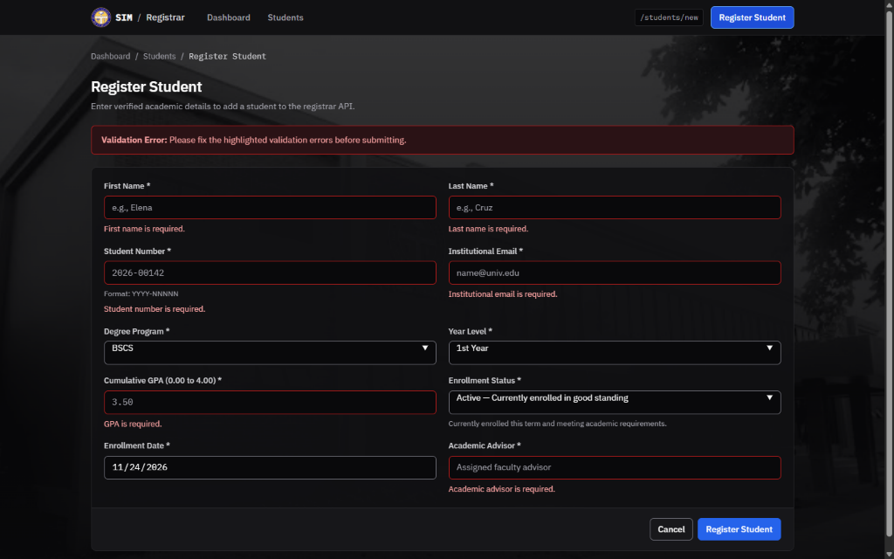
   *Figure 3a: Registration form (`/students/new`) showing the validation summary banner and inline error feedback on incomplete or invalid fields.*

   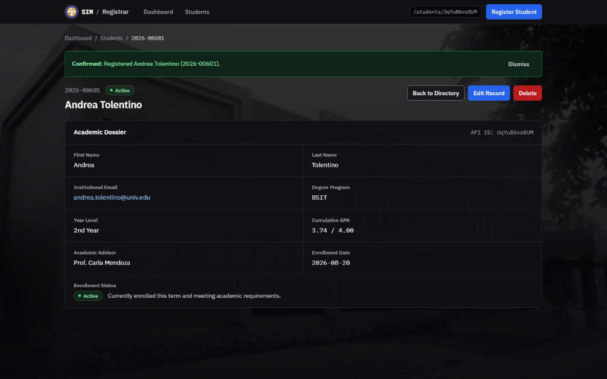
   *Figure 3b: Confirmation banner and saved Academic Dossier displayed immediately after a valid `POST /students` registration.*

4. **Viewing, Editing, and Deleting a Student Record (`/students/:id`):**
   - On a student's Academic Dossier, click **Edit Record** (URL updates to `/students/:id?edit=true`), modify any fields, and click **Save Changes** (or **Cancel** to discard).
   - To remove a record, click **Delete** from either the directory row or the student dossier, review the confirmation dialog, press **Escape** / **Cancel** to abort, or click **Delete Record** / **Confirm Delete** to remove it permanently.
   - If the local API server (`npm run api`) is offline, an alert banner appears; restart the API and click **Retry** to recover immediately.

   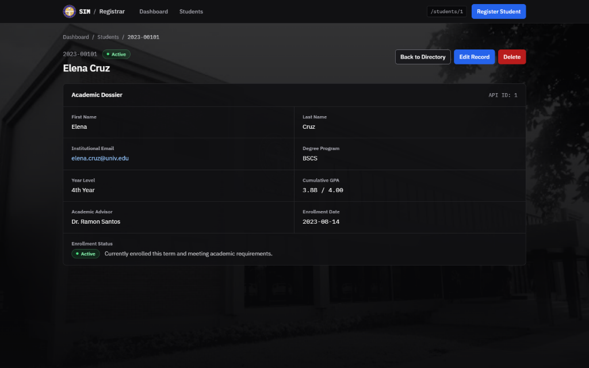
   *Figure 4a: Read-only Academic Dossier (`/students/1`) providing direct navigation to Edit Record and Delete actions.*

   
   *Figure 4b: Keyboard-accessible delete confirmation dialog (`Remove Student Record`) requiring explicit confirmation before removing a record.*

---

## 11. Testing Results

### 11.1 Automated Unit Tests (Vitest)
Executed via `npx ng test --watch=false` following final code edits:
- `src/app/services/student.service.spec.ts`: **6 passed / 6 total** (GET list, multi-criteria search/filter, POST create, PUT update, DELETE remove, HTTP status 0 error mapping).
- `src/app/app.component.spec.ts`: **2 passed / 2 total** (root shell rendering with `<app-navbar>` + `<router-outlet>`, route redirects `/` -> `/dashboard`, `/students/new` precedence, wildcard fallback `/**` -> `/dashboard`).
- **Build & Typecheck:** `npx tsc --noEmit` exited `0`; `npm run build` produced `dist/student-information-manager` (`387.61 kB` initial bundle, `97.16 kB` transfer) with **0 errors and 0 warnings**.

### 11.2 End-to-End Functional Test Cases (10 Cases)
All 10 test cases were executed live against the running Angular development server (`http://localhost:4200`) and local `json-server` mock API (`http://localhost:3000/students`).

| Test ID | Category | Test Scenario & Steps | Expected Result | Actual Result | Status |
| --- | --- | --- | --- | --- | --- |
| **TC-01** | Routing & Normal Load | 1. Open `http://localhost:4200/`.<br>2. Wait for `GET /students` to resolve. | Redirects to `/dashboard`; shows 5 enrolled students, 3 Active, 2 Probation/On Leave, Mean GPA `3.24`, course/year breakdowns, and 5 recent rows. | Redirected to `/dashboard`; rendered `5`, `3`, `2`, `3.24`, BSCS `2 (40%)`, all 4 year levels, and 5 recent rows. Console errors: `0`. | **PASS** |
| **TC-02** | Angular Router Drill-Down | 1. On `/dashboard`, click `BSCS` in Enrollment by Program.<br>2. Click `Clear Filters`. | Navigates to `/students?course=BSCS` showing 2 BSCS records; clearing filters returns URL to `/students` with all 5 records. | URL updated to `/students?course=BSCS` (Elena Cruz, Hannah Reyes); `Clear Filters` restored `/students` and all 5 rows. | **PASS** |
| **TC-03** | Search, Filters & Empty State | 1. Choose Course `BSCS` and Year `2nd Year`.<br>2. Type `zzzz-no-match` in Search.<br>3. Click `Reset Filters`. | Filters down to Hannah Reyes (`?course=BSCS&yearLevel=2`); search displays `"No matching students"`; reset restores 5 rows. | URL became `/students?course=BSCS&yearLevel=2` (1 row); non-matching query displayed `"No matching students"`; `Reset Filters` restored 5 rows. | **PASS** |
| **TC-04** | Invalid Input Validation | 1. Open `/students/new` and submit blank form.<br>2. Enter Student No. `123`, Email `not-an-email`, GPA `4.9` and submit. | Blocks HTTP `POST`; shows validation summary banner and inline messages below each invalid field. | Remained on `/students/new`; showed `"Validation Error"` banner plus inline errors for Student Number, Full Name, Email, GPA range, and Advisor. | **PASS** |
| **TC-05** | Create CRUD & Persistence | 1. Register valid student `Andrea Tolentino` (`2026-00601`, `BSIT`, 2nd Year, GPA `3.74`).<br>2. Submit and reload browser. | Sends `POST /students` (`201 Created`), navigates to `/students/:newId`, shows confirmation banner, and persists after reload. | Redirected to `/students/Kub7wECDAIQ` with confirmation banner; full page reload fetched and displayed the identical persisted record. | **PASS** |
| **TC-06** | Update CRUD & Persistence | 1. Click `Edit Record` on Andrea Tolentino.<br>2. Change GPA to `3.91` and Standing to `Probation`.<br>3. Click `Save Changes` and reload. | URL appends `?edit=true` with prefilled inputs; `PUT /students/:id` saves updates, returns to view mode with confirmation banner, and persists after reload. | Navigated to `?edit=true`, saved via `PUT`, displayed `"Confirmed: Saved updates for Andrea Tolentino."`, `3.91 / 4.00`, and `Probation`; persisted after reload. | **PASS** |
| **TC-07** | Delete CRUD & Keyboard Cancel | 1. On `/students`, click `Delete` on Andrea Tolentino.<br>2. Press `Escape`.<br>3. Click `Delete` again and confirm `Delete Record`. | Confirmation dialog opens; `Escape` cancels without deleting; confirming sends `DELETE /students/:id`, shows banner, and restores count to 5. | `Escape` closed `alertdialog` (count stayed 6); confirming deleted the record, showed confirmation banner, and returned count to 5. | **PASS** |
| **TC-08** | Invalid Route Parameter | 1. Navigate directly to `http://localhost:4200/students/999`.<br>2. Click `Back to Student Directory`. | Handles `404 Not Found` cleanly with error message and recovery link back to `/students`. | Rendered `"Unable to open student record"` and `"The requested student record was not found."`; button returned cleanly to `/students`. | **PASS** |
| **TC-09** | Wildcard Route & Responsive Reflow | 1. Navigate to `/does-not-exist`.<br>2. Test `390x844` and `768x1024` viewports.<br>3. Toggle mobile `Menu` and close via `Escape`. | Redirects to `/dashboard`; zero horizontal overflow across viewports; mobile drawer opens and closes via `Escape`. | Redirected to `/dashboard`; zero overflow on `390x844` and `768x1024`; mobile `Menu` opened (`aria-expanded="true"`) and closed on `Escape`. | **PASS** |
| **TC-10** | API Failure & Recovery | 1. Stop `json-server` on port `3000`.<br>2. Reload `/dashboard` and open `/students`.<br>3. Restart API and click `Retry`. | Displays actionable offline error banner citing `http://localhost:3000` with zero crashes; clicking `Retry` clears banner and reloads all 5 students. | Both views rendered alert banners (`"Cannot reach the local API server at http://localhost:3000..."`) with 0 console errors; clicking `Retry` recovered all 5 records. | **PASS** |

---

## 12. Member Contribution Report and Individual Reflections

### 12.1 Signed Member Contribution Table
All group members actively participated in exploring **Angular Router**, contributing code, reviewing changes, and studying the full application for individual defense questioning.

| Member's Name | Assigned Tasks | Actual Contributions | Files/Features Developed | Signature |
| --- | --- | --- | --- | --- |
| **Joevan Delos Santos** | Project coordination, component structure, routing, interface, forms, styling, and integration | Coordinated team milestones, designed standalone component architecture, configured Angular Router & HTTP providers, built root shell & sticky navbar with live path indicator, designed global WCAG AA dark-zinc CSS tokens and responsive mobile table-to-card reflow, implemented template-driven student registration/edit forms with two-way `[(ngModel)]` bindings and inline validation feedback, and led integration across all pages. | `src/app/app.config.ts`, `src/app/app.routes.ts`, `src/app/app.component.*`, `src/app/components/navbar/*`, `src/styles.css`, `src/app/components/dashboard/*`, `src/app/components/student-detail/student-detail.component.html`, `src/app/components/student-detail/student-detail.component.css` | ______________________ |
| **Richmon Ecal** | Services, API integration, and data persistence | Defined TypeScript student models/enums, built root-injected `StudentService` with full `HttpClient` CRUD, RxJS multi-criteria search projection, centralized `HttpErrorResponse` translation, and `json-server` `db.json` persistence. | `src/app/models/student.model.ts`, `src/app/services/student.service.ts`, `db.json`, `package.json` (`api` script) | ______________________ |
| **John Yzhekiel Millar** | Testing, verification, and directory filter integration | Implemented URL-synced debounced search and Course/Year filters in the Student Directory, authored automated Vitest specs for `StudentService` and route matching, and verified persistence and offline recovery behavior. | `src/app/components/student-list/*`, `src/app/services/student.service.spec.ts`, `src/app/app.component.spec.ts` | ______________________ |
| **Celine Licanda** | Documentation coordination, QA testing, and verification | Executed all 10 live end-to-end test cases (`TC-01`–`TC-10`), verified responsive accessibility and keyboard flows (`Escape` dismissal), authored API & Router documentation sections, and coordinated final PDF & slide deliverables. | `docs/PROJECT_DOCUMENTATION.md`, `docs/PROJECT_DOCUMENTATION.html`, `README.md`, QA verification (`TC-01`–`TC-10`) | ______________________ |

### 12.2 Individual Reflections

#### Joevan Delos Santos: Coordination, Routing, Interface, Forms, and Integration
Working on this project really helped me understand the new Angular standalone setup. Not using NgModules and just using provideRouter() made connecting the pages very easy. The biggest problem I had was a routing error. When we clicked "Register Student", it gave a 404 error. This happened because the router read the students/:id link before the students/new link. I moved the static route to the top and it fixed the bug. I also handled the interface design, forms, and styling, where making a big data table and multi-field form look good on mobile phones required custom CSS rules so the table rows turn into small cards without overflowing sideways. Using two-way data binding with Angular directives and adding aria-invalid for accessibility were great learning experiences while setting up the root files, configuring the routes, and making sure everyone's work connected together well.

#### Richmon Ecal: Services, API, and Persistence
My main task was putting all the backend communication inside the StudentService. By using @Injectable and RxJS observables, I kept our user interface completely separate from the direct HTTP links. We had an unexpected issue when the new json-server update removed the old full-text search feature. Because of this, our search filter stopped working. I fixed it by writing a custom search function using the map() operator. This task really helped me learn how to handle data from the API safely.

#### John Yzhekiel Millar: Directory Filters and Automated Testing
While making the project, I saw a big problem with the browser history. If a user typed or deleted words in the search filter quickly, it added many empty parameters to the URL. Because of this, the user had to click the back button many times just to leave the page. I fixed this by adding replaceUrl: true in the routing code so the history stays clean. Doing this fix and writing the Vitest automated tests taught me how to use RxJS tools like debounceTime so we don't send too many requests to the server.

#### Celine Licanda: End-to-End QA and Documentation
Testing the application manually gave me an important view on how it actually works. While testing different things, I found a bug where going straight to a newly created student profile did not show the new data. This happened because the page was reading the old route data instead of refreshing. I wrote this down so the team could fix it using a reactive combineLatest method. Other than checking all our ten test cases and keyboard usage, I was the one who arranged and typed the final project documentation to make sure we met all the school requirements.

---

## 13. Conclusion and Recommendations

### 13.1 Accomplishments
Group 1 successfully delivered the **Student Information Manager**, a fully functional, API-connected Angular 22 single-page application that meets every functional, architectural, and exploration requirement. The application supports persistent CRUD operations, real-time multi-criteria search and filtering, URL-driven navigation across separate Dashboard, Directory, Registration, and Student Detail views, responsive dark-mode styling, and complete loading/empty/validation/error feedback—backed by 8 passing Vitest specs and 10 passing end-to-end test cases.

### 13.2 Key Lessons Learned
- Designing routes deliberately—placing static segments above dynamic `:id` parameters and subscribing reactively to `ActivatedRoute` streams—prevents subtle navigation and component-reuse bugs.
- Keeping all API calls inside an injected service (`StudentService`) and binding UI state through Signals makes zoneless Angular 22 apps predictable, testable, and resilient to network failures.
- Synchronizing search and filter controls with URL query parameters dramatically improves usability by making filtered views reload-safe and bookmarkable.

### 13.3 Recommendations for Future Improvements
1. **Production Backend & Relational Database:** Replace `json-server` (`db.json`) with a transactional REST API (e.g., Node.js/Express or ASP.NET Core with PostgreSQL) to support concurrent multi-user writes, server-side pagination, and indexed full-text search.
2. **Authentication & Role-Based Access Control (RBAC):** Add login authentication and Angular route guards (`CanActivateFn`) so Registrar Clerks have write privileges while Faculty Advisors have read-only access.
3. **Per-Semester Academic History & Uniqueness Enforcement:** Expand the schema to track semester-by-semester grades/transcripts and enforce server-side uniqueness checks on `studentNumber` and `email`.
4. **Data Export & Reporting:** Add CSV/PDF roster export from the filtered Student Directory for registrar reporting.

---

## 14. References

### Official Documentation & Tutorials
1. Angular Team. *Routing in Angular — Official Guide*. https://angular.dev/guide/routing
2. Angular Team. *`ActivatedRoute` API Reference*. https://angular.dev/api/router/ActivatedRoute
3. Angular Team. *`Router` and `RouterLinkActive` API Reference*. https://angular.dev/api/router/Router
4. Angular Team. *Angular Zoneless Change Detection & Signals Guide*. https://angular.dev/guide/zoneless
5. Angular Team. *HTTP Client (`provideHttpClient`) Guide*. https://angular.dev/guide/http
6. RxJS Team. *RxJS Overview & Operators (`switchMap`, `combineLatest`, `debounceTime`, `catchError`)*. https://rxjs.dev/guide/overview
7. Typicode. *`json-server` — Full Fake REST API Documentation*. https://github.com/typicode/json-server
8. Vitest Team. *Vitest Testing Framework Documentation*. https://vitest.dev/guide/

### Typography, Icons, and Visual Assets
9. IBM Corporation. *IBM Plex Sans & IBM Plex Mono Typefaces* (loaded via Google Fonts in `src/index.html`). https://fonts.google.com/specimen/IBM+Plex+Sans
10. Brand Seal (`SIM / Registrar`): Institutional seal (`public/dyci-logo.png`, Dr. Yanga's Colleges, Inc.) rendered directly in `src/app/components/navbar/navbar.component.html`.
